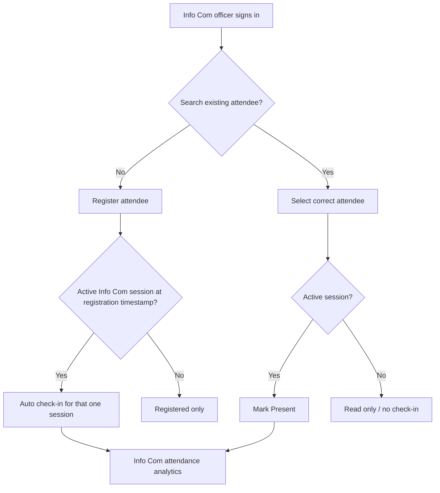
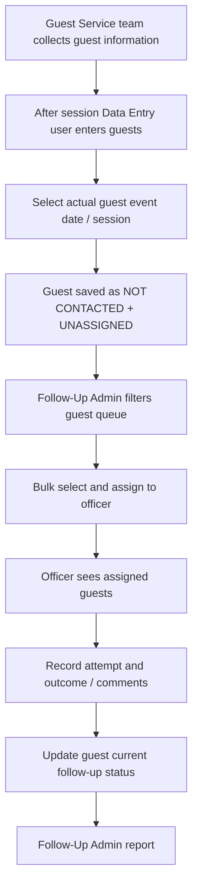

# 02 — Workflows and state transitions

## Info Com workflow

Default absent is a derived status for *each* session with no check-in. The UI should never accidentally mark one person's status for all eight sessions. On Oct 31 and Nov 1 the active session, not date alone, determines auto-attendance.

## Guest Service workflow

**Separation example:** Mike is registered in Info Com on Oct 27. Mike may later be entered independently by Guest Service with gender, home address and notes. These remain two records in separate domain tables even if both have the same phone number. There is no matching, merging, deduplication across domains, or attendance-driven follow-up action.

## Guest states
- On create: current follow-up status = `NOT CONTACTED`; assignment = unassigned.
- On assignment: `NOT CONTACTED` remains unless updated by an authorized actor.
- `CONTACTED`: two-way guest contact completed; log date, method and remark.
- `UNREACHABLE`: attempt made, unable to reach; log details.
- New follow-up attempts create immutable-ish `follow_up_activities`; current status can change as outcomes evolve; previous statuses and assignment history persist.
- On reassignment, close old assignment transactionally and open new active assignment. Never erase earlier assignment/activity history.

## Correction and deletion
Prefer archive or soft-delete with reason. Only administrators can undo incorrect check-ins or reassign protected records. Never allow hard deletion of history through ordinary screens. Preserve original import/source event and logged actor.

## Edge cases
- Identical phone values can represent different people *within* a domain; do not blindly merge. Search offers selectable matches.
- A guest added after the end of a session must be labelled with the true guest session/date selected by Data Entry; database `created_at` remains actual input time.
- The 2025 guest workbook may have contact statuses already entered; migration must preserve original status and comments, while tracking an explicit legacy import source.
- Guest records are not enrolled in Info Com's absent population.

## Confirmed Guest Service session selection
Every new guest entry requires a selection from `conference_sessions`. Data Entry must explicitly choose the actual session; retain that choice across consecutive entries in a batch. Never infer encounter session from database creation time. Admin queues support session filtering and bulk assignment within the filtered selection; officers see the authoritative day/session label on each assigned guest.
