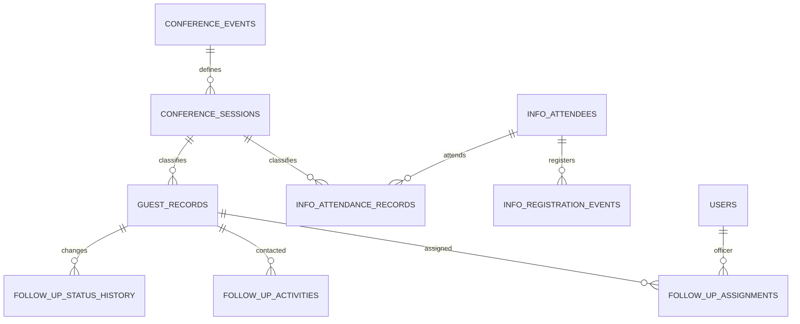

# 04 — Database design

Updated 18 October 2026 from prompts 1–3. The implemented Phase 1 migrations are authoritative for physical column types. All instants are UTC; local conference dates and times are Africa/Lagos.

## Shared identity and conference configuration

- `users`: Laravel id/name/email/password/remember token, active flag (default true), last login and timestamps. Email is unique; passwords are hashed.
- `roles`, `permissions`, `role_user`, `permission_role`, `permission_user`: five roles, role permission grants and optional explicit individual grants. Policies and gates enforce access.
- `conference_events`: unique year, name, starts_on, ends_on, timezone.
- `conference_sessions`: event FK, unique code, day_number, date_local, name (General/Morning/Evening), human-readable label, nullable starts_at_utc/ends_at_utc, enabled (default false), nullable attendance_locked_at. Eight 2026 sessions are seeded without guessed boundaries.
- `audit_logs`: nullable actor, domain (platform/info_com/follow_up), action, subject type/id, redacted before/after JSON, source IP/user agent and occurred_at. Application writes append-only events.
- `app_settings`: unique key, JSON value, nullable updating actor and timestamps. The settings schema is reserved; a general settings editor and retention policy are future work.
- Standard Laravel password reset, database session, cache, job and failed-job tables.

The shared `conference_sessions` name supersedes the older `info_conference_sessions` proposal. Session classification is a shared lookup, never a shared participant identity.

## Info Com only

`info_attendees`: first_name, last_name, phone_raw, nullable indexed phone_normalized, email; nullable member, summit_centre, commits_to_invite, invite_count, location, abuja_area, first_time, bus_shuttle, bus_route, attendance_preference, heard_about, feedback, consent; registration_original_at_utc, registration_source (onsite/csv/other), source_external_id, raw_source_json, created_by_user_id, timestamps, soft deletion. Shared phone values are allowed.

`info_registration_events`: attendee FK, source (onsite/csv), registered_at_utc, nullable Info Com import row FK, creator FK, nullable unique source_fingerprint, timestamps. Original source time drives future automatic attendance, never upload time.

`info_attendance_records`: attendee FK, required conference_session_id FK, checked_in_at_utc, source (manual/registration_auto/csv_auto/admin_adjustment), marker FK, registration event FK, Info Com import row FK, nullable voided_at/void_reason, timestamps. Unique (info_attendee_id, conference_session_id) enforces one row per pair. A future privileged void/restore workflow updates that row and audits corrections; it does not append a second pair. Absence is derived, not stored.

`info_import_batches`: event FK, filename, SHA256, uploader FK, processing status, row/result counters, mapping JSON, summary JSON, timestamps.
`info_import_rows`: batch FK, row_number, optional worksheet_name, raw/normalized JSON, row fingerprint, classification, error JSON, processing state, nullable attendee FK, timestamps. Unique (batch_id, row_number).

## Guest Service / Follow-Up only

`guest_records`: required conference_session_id FK; full_name, nullable first_name/last_name; phone_raw, nullable indexed phone_normalized; optional gender, home_address, heard_about, captured_at_original_utc, entry_notes; current_status enum (NOT CONTACTED/CONTACTED/UNREACHABLE) default NOT CONTACTED; nullable creator FK, Guest Service import row FK, legacy_officer_name, raw_source_json, archived_at, timestamps.

Each guest row represents an independently captured encounter. Its session owns the date/day/label; do not store editable duplicate event_date_local/event_session_label fields. The selection is required even when captured after the conference. Future profile reconciliation is confined to Guest Service. A 2025 import must reference separately configured 2025 event sessions.

`follow_up_assignments`: guest FK, officer FK, assigning actor FK, assigned_at, nullable unassigned_at/reason, timestamps. A generated active_guest_id is guest_record_id while unassigned_at is null, otherwise null. A unique index enforces exactly zero or one active owner per guest, retaining any number of closed historical assignments. Future assignment operations also lock guest rows transactionally.

`follow_up_activities`: guest FK, optional assignment FK, actor FK, method (call/sms/whatsapp/visit/other), attempted_at_utc, outcome (CONTACTED/UNREACHABLE/NOTE_ONLY), comment, previous_status, nullable new_status and timestamps.

`follow_up_status_history`: guest FK, nullable from_status, to_status, optional actor FK, changed_at_utc, reason, optional activity FK. Status constraints are database enforced. Transactional contact/status services arrive in Phase 4; plain notes never imply successful contact.

`guest_import_batches` and `guest_import_rows`: independent equivalents of Info Com tracking, including worksheet name, raw payload, mappings, validation and nullable guest destination. These never point at Info Com import tables. Preview/commit/retry and historical mapping UI are later-phase workflows.

## Integrity and relationships

No attendee–guest foreign key, shared participant model, phone matching or synchronization exists. Same names/phones across domains are incidental.

Database checks reject incomplete enabled session boundaries, start >= end, and assignment end before assignment start. SessionSchedule serializes edits through an event row lock and rejects overlap with any enabled interval. Half-open boundaries allow adjacent windows. UTC-bound comparisons and one-unique-match lookup underpin later attendance.

Indexes cover attendee names/phone/original registration, session date/start, attendee/session uniqueness, guest name/phone/session/status, officer/active assignment, activity time and import provenance. Restrictive foreign keys protect operational history; nullable actor references may clear when accounts are removed. Ordinary application screens expose no history deletion.

Within-domain deduplication must use reviewed identity/provenance, never phone alone. Import fingerprint uniqueness/retry decisions beyond registration-event fingerprints require the later importer service.

